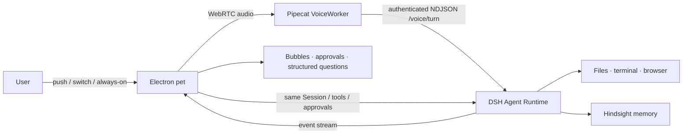

# Nisse / dsh-bot

English | [中文](README.zh.md)

   

> **A voice agent that lives on your desktop** — it listens while you speak, acts through real tools, remembers across sessions, and stops to ask before side effects.

<p align="center">
  <video src="https://github.com/user-attachments/assets/2c0160ec-7c47-4528-9941-7f6445abbf5d" controls width="860"></video>
  <br>
  <sub>Full demo (2:31, 720p) · Storyboard and narration: <a href="docs/demo/SCRIPT.zh.txt">docs/demo/SCRIPT.zh.txt</a></sub>
</p>

Nisse (dsh-bot) is a macOS desktop pet that turns a conversation model into an agent living on your desktop. The pet is the entry point, DSH is the only agent runtime, Pipecat handles realtime voice, and Hindsight provides long-term memory. File, terminal, and browser actions run through the DSH toolchain instead of being described in text.

## Core features

- **Voice first** — push-to-talk, switch-to-talk, and always-listening confirmation, with replies in a bubble next to the pet.
- **Real actions** — files, terminals, and browsers are executed through the DSH agent toolchain.
- **Approval before side effects** — write actions ask first, with allow once, deny, and always allow matched on tool, working directory, and arguments.
- **Long-term memory** — Hindsight remembers preferences, names, and ongoing work across sessions and restarts.
- **Interruptible** — saying "stop" during playback stops speech only; stopping a task is a separate action with its own receipt.
- **Native desktop presence** — draggable pet, main window, Dock and menu bar entry, system notifications, and a clean quit.

## Architecture



- **DSH** is the only agent runtime, pinned to `0.2.1-rc.3`; voice does not start a second agent.
- **Pipecat** owns realtime ASR/TTS, VAD, barge-in, and the media lifecycle.
- **Hindsight** owns cross-session memory through a local sidecar.
- **Electron** owns the pet, bubbles, main window, Dock and menu bar, and macOS integration.

## Quick start <a id="run"></a> <a id="run-from-source"></a>

Requirements: Apple Silicon Mac, macOS 14+, Node.js 22.19+ or 24+, `uv`, Xcode Command Line Tools, and 8 GiB of free disk space.

```bash
git clone https://github.com/SisyphusZheng/dsh-bot.git
cd dsh-bot
bash product/tools/build-macos.sh
bash product/tools/install-macos.sh "$(node -p "require('./.mvv-build/evidence/macos-build.json').artifact.path")"
```

After the first launch, open DSH settings → Bot and add your LLM and DashScope keys. The build is ad-hoc signed and not notarized, so macOS Gatekeeper blocks the first open; this build is for local evaluation only.

## Status

0.0.1 is engineering-complete and UAT-incomplete (RESULT B). Automated gates pass and real-provider voice, tool, and approval flows have been exercised, but human-voice ten-turn conversation and barge-in, TCC permissions, physical desktop interaction, a 30-minute soak, and fault injection are still unverified. Developer ID signing, notarization, and auto-update are out of scope for 0.0.1.

Current version, artifact hashes, gate results, and remaining checks live in [product/CURRENT-STATUS.md](product/CURRENT-STATUS.md); this README does not duplicate them.

## Repository layout

```text
apps/desktop/                    Electron shell, main window, pet runtime
product/pet/                     Pet UI, bubbles, voice interaction, onboarding, skins
product/voice-worker-src/        Pipecat VoiceWorker, ASR/TTS, voice control
nisse/packages/host-integration/ Host/Bridge integration with DSH
product/tools/                   Build, acceptance, install, and measurement tools
product/CURRENT-STATUS.md        Single source of current facts
docs/                            Product, architecture, roadmap, and demo script
```

## Roadmap

- **0.0.1** — stable voice, approvals, desktop experience, and macOS packaging.
- **0.0.2** — CUA and desktop operation, DS-Bot adaptation.
- **0.0.3** — local TTS, motion coordination, simpler first run.
- **0.0.4** — full app plus DSH plugin and companion dual delivery.
- **1.0** — cloud execution, multi-bot collaboration, unified memory, dual delivery.

The roadmap is a plan, not shipped behavior; approved ordering and task books live under `docs/roadmap/` (Chinese).

## Contributing and safety

- [CONTRIBUTING.md](CONTRIBUTING.md) — build, test, and submission workflow.
- [SAFETY.md](SAFETY.md) — security model, approval boundaries, and reporting.
- [LICENSE](LICENSE) — MIT, with third-party notices in [THIRD_PARTY_NOTICES.md](THIRD_PARTY_NOTICES.md).
