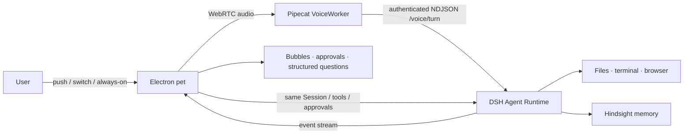

# Nisse / dsh-bot

[English](README.md) | 中文

   

> **一个住在桌面上的语音 Agent** —— 你说话时它在听，用真实工具做事，跨会话记住你，在产生副作用之前先停下来问你。

<p align="center">
  <video src="https://github.com/user-attachments/assets/2c0160ec-7c47-4528-9941-7f6445abbf5d" controls width="860"></video>
  <br>
  <sub>完整演示（2 分 31 秒，720p）· 分镜与旁白见 <a href="docs/demo/SCRIPT.zh.txt">docs/demo/SCRIPT.zh.txt</a></sub>
</p>

Nisse（dsh-bot）是一个 macOS 桌面宠物形态的个人 Agent：桌宠是入口，DSH 是唯一 Agent Runtime，Pipecat 负责实时语音，Hindsight 负责长期记忆。文件、终端、浏览器操作都走 DSH 工具链真实执行，而不是只回一段文字。

## 核心能力

- **语音优先** — 按住说话、切换说话、常听确认三种输入方式，回复直接出现在桌宠旁的气泡里。
- **真的能做事** — 文件、终端、浏览器操作通过 DSH Agent 工具链真实执行。
- **副作用前审批** — 写操作先审批，支持允许一次、拒绝、始终允许，按工具、工作目录和参数精确匹配。
- **长期记忆** — Hindsight 跨会话、跨重启记住偏好、称呼和正在做的事。
- **可打断** — 播报中说“停一下”只停播报；停止任务是另一个动作，有独立的回执。
- **原生桌面存在** — 桌宠拖动、主窗口、Dock 与菜单栏入口、系统通知、干净退出。

## 架构



- **DSH** 是唯一 Agent Runtime，固定 `0.2.1-rc.3`；语音不另起一套 Agent。
- **Pipecat** 负责实时 ASR/TTS、VAD、打断与媒体生命周期。
- **Hindsight** 通过本地 sidecar 负责跨会话记忆。
- **Electron** 负责桌宠、气泡、主窗口、Dock 与菜单栏，以及 macOS 集成。

## 快速开始 <a id="run"></a> <a id="run-from-source"></a>

要求：Apple Silicon Mac、macOS 14+、Node.js 22.19+ 或 24+、`uv`、Xcode Command Line Tools，以及 8 GiB 可用磁盘空间。

```bash
git clone https://github.com/SisyphusZheng/dsh-bot.git
cd dsh-bot
bash product/tools/build-macos.sh
bash product/tools/install-macos.sh "$(node -p "require('./.mvv-build/evidence/macos-build.json').artifact.path")"
```

首次启动后，在 DSH 设置 → Bot 中填写 LLM 与 DashScope Key。构建使用 ad-hoc 签名、未做公证，macOS Gatekeeper 会拦截首次打开；该构建仅用于本地评估。

## 状态

0.0.1 工程完成、UAT 未完成（RESULT B）。自动化门禁通过，真实 Provider 的语音、工具与审批链路已实测，但真人语音十轮对话与抢话、TCC 权限、物理桌面交互、30 分钟连续使用和故障注入仍未验证。Developer ID 签名、公证与自动更新不在 0.0.1 范围内。

当前版本、产物 SHA、门禁结论与剩余检查统一维护在 [product/CURRENT-STATUS.md](product/CURRENT-STATUS.md)；本 README 不复制这些事实。

## 目录速览

```text
apps/desktop/                    Electron shell, main window, pet runtime
product/pet/                     Pet UI, bubbles, voice interaction, onboarding, skins
product/voice-worker-src/        Pipecat VoiceWorker, ASR/TTS, voice control
nisse/packages/host-integration/ Host/Bridge integration with DSH
product/tools/                   Build, acceptance, install, and measurement tools
product/CURRENT-STATUS.md        Single source of current facts
docs/                            Product, architecture, roadmap, and demo script
```

## Roadmap

- **0.0.1** — 稳定语音、审批、桌面体验与 macOS 打包链路。
- **0.0.2** — CUA 与桌面操作、DS-Bot 适配。
- **0.0.3** — 本地 TTS、动作协调、首启简化。
- **0.0.4** — 完整 App 加 DSH 插件与伴随程序双交付。
- **1.0** — 云端持续执行、多 Bot 协作、统一记忆与双交付。

路线图是计划，不是已完成功能；已批准顺序与任务书在 `docs/roadmap/`（中文）。

## 贡献与安全

- [CONTRIBUTING.zh.md](CONTRIBUTING.zh.md) — 构建、测试与提交流程。
- [SAFETY.zh.md](SAFETY.zh.md) — 安全模型、审批边界与报告方式。
- [LICENSE](LICENSE) — MIT，第三方声明见 [THIRD_PARTY_NOTICES.md](THIRD_PARTY_NOTICES.md)。
