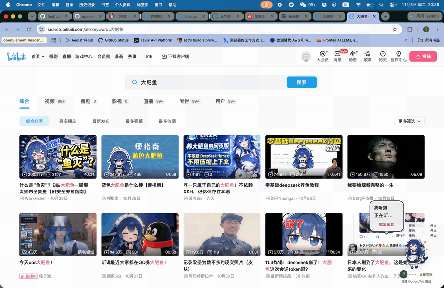
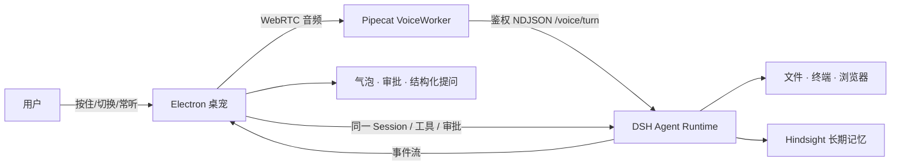

# Nisse / dsh-bot

[English](README.md) | 中文

> **一个住在桌面上的语音 Agent：能听、能做、有记忆，也有边界。**
>
> 不是“聊天框里多了一个模型”，而是把 Agent 放进真实桌面：桌宠是入口，DSH 是唯一 Agent Runtime，Pipecat 负责实时语音，Hindsight 负责长期记忆。

<p align="center">
  <a href="docs/demo/dsh-bot-0.0.1-demo.mp4"></a>
  <br>
  <sub>动图预览（20 秒）· <a href="docs/demo/dsh-bot-0.0.1-demo.mp4">完整演示视频（2 分 31 秒，1080p MP4）</a>（GitHub 网页不能直接播放仓库内 MP4 时，点开后用 Download）· 分镜与旁白见 <a href="docs/demo/SCRIPT.zh.txt">docs/demo/SCRIPT.zh.txt</a></sub>
</p>

当前状态只看 [product/CURRENT-STATUS.md](product/CURRENT-STATUS.md)：产品版本、开发分支、候选包身份、原生打包自动验收的结论，以及真人声学/TCC/真实 Provider/个人记忆库等人工边界都在那里维护；本 README 不复制版本、提交号、产物 SHA 与验收计数。

---

## 这是什么

一个 macOS 桌面宠物形态的个人 Agent：

- **语音优先**：按住说话、切换说话、常听确认三种输入方式；桌面宠物旁边直接出气泡。
- **真的能做事**：文件、终端、浏览器等操作走 DSH Agent 的工具链，不是只回一段文字。
- **有安全边界**：有副作用的操作先审批；支持“允许一次 / 拒绝 / 始终允许”，语音与气泡共享同一份状态。
- **有长期记忆**：跨会话记住你的偏好、称呼和正在做的事。
- **打断和安全停止**：播报中可以“停一下”；停止播报和停止任务是两件事，回执分开。
- **住在桌面里**：桌宠拖动、双击打开主窗口、Dock/菜单栏入口、系统通知、可退出。

一句话：**把“能对话的模型”变成“住在你桌面上的 Agent”，并且让它在真实操作前停下来问你。**

---

## 为什么不是又一个 Chatbot

| 常见聊天框 | Nisse / dsh-bot |
|---|---|
| 你打开网页，输入文字 | 桌宠常驻桌面，语音直接说 |
| 回答完就结束 | 任务、审批、队列、恢复是完整生命周期 |
| “我正在帮你做” | 真实执行，副作用前必须审批 |
| 换个会话就失忆 | Hindsight 跨会话长期记忆 |
| 打断 = 关页面 | 语音打断、停止播报、停止任务分别处理 |
| 只在一个标签页里 | Electron 原生窗口、Dock、通知、快捷键、桌宠 |

**独特定位：桌面上的语音 Agent，不是聊天框里的 Agent。**

---

## 90 秒能看到的流程

1. **语音下达任务**：说一句要做的事，桌宠显示识别与执行状态。
2. **中途打断**：播报中说“停一下”，只停播报，任务继续；再说“继续”。
3. **副作用审批**：写工作区外文件前弹审批，说“我允许一次”，只执行一次。
4. **记忆召回**：问“还记得我上次说的偏好吗？”，从 Hindsight 取回。
5. **桌面交互**：拖动桌宠、双击主窗口、Dock 图标、退出。

> 演示重点是“语音 Agent 的完整闭环”，不是功能清单。

---

## 架构



- **DSH** 是唯一 Agent Runtime（固定 `0.2.1-rc.3`），语音不另起一套 Agent。
- **Pipecat** 负责实时 ASR/TTS、VAD、打断与媒体生命周期。
- **Hindsight** 负责跨会话记忆；Memory 服务是本地 sidecar。
- **Electron** 负责桌宠、气泡、主窗口、Dock/菜单栏、系统集成。

---

## 三个真正难的地方

### 1. 实时语音不是“把 ASR 接上”就完了

- 半双工会显得迟钝，全双工又会被回声/环境声误触发；
- 做的是：VAD + 回声候选过滤 + 打断确认 + 控制词消费 + 停止回执；
- 常听模式的普通输入先确认，避免“环境声直接变成任务”。

### 2. 审批是产品边界，不是弹窗

- 审批必须把**工具、工作目录、参数**展示清楚；
- “允许一次”只对本次生效；“始终允许”只匹配同一工具+目录+完全相同的参数；
- 语音说“我允许一次”和点击气泡必须走同一条状态机，不能一边批准、一边又生成新任务。

### 3. 桌面窗口是另一个操作系统

- 桌宠/气泡要浮在普通窗口、全屏窗口和 DSH 主窗口之上；
- 打包时 Electron 的 ASAR 完整性、ad-hoc 签名顺序、Frameworks 签名、LaunchServices 启动互相影响；
- 这些不是“UI 细节”，是 Mac 上能不能正常打开的问题。

---

## 工程验证

门禁状态、验收计数、产物 SHA 与证据路径统一见 [product/CURRENT-STATUS.md](product/CURRENT-STATUS.md)；本 README 不再复制容易过时的数字。历史候选的验收记录保存在交付包与内部归档中（不随公开仓库发布），构建与验收脚本在 `product/tools/`。安全默认权限与越界审批（S1–S3）、取消入口与凭据写入的结论、以及各自**未覆盖的入口**，都以索引中的对应章节为准（本 README 不复述边界）。

可复核的入口：

- 打包验收与气泡层级修复记录：保存在交付包与内部归档中，不随公开仓库发布
- 构建/验收脚本：[`product/tools/build-macos.sh`](product/tools/build-macos.sh)、[`product/tools/accept-macos.sh`](product/tools/accept-macos.sh)

### 还没验证的

- 真人麦克风/外放回声/蓝牙耳机/十轮连续对话/抢话；
- TCC、鼠标穿透、Spaces、多屏缩放、物理拖动；
- 真实 Provider（ASR/TTS/LLM）完整长对话与首次配置；
- 真实个人 Hindsight 库的查看/纠正/删除/导出与跨重启召回；
- Developer ID 签名与公证、更新源、体积/冷启动优化。

**不把“代码写完了”说成“已经验收通过”。**

---

<a id="run"></a>
<a id="run-from-source"></a>

## 快速开始（macOS）

要求：Apple Silicon、macOS 14+、Node 24+、uv、Xcode Command Line Tools。

```bash
git clone https://github.com/SisyphusZheng/dsh-bot.git
cd dsh-bot
git switch work/0.0.1-closure-final

bash product/tools/build-macos.sh
bash product/tools/verify-local.sh
bash product/tools/accept-macos.sh "$(node -p "require('./.mvv-build/evidence/macos-build.json').artifact.path")"
```

安装：

```bash
bash product/tools/install-macos.sh /path/to/dsh-bot.app
```

首次启动后在 DSH 设置 → Bot 中填写 LLM 与 DashScope Key；语音即可使用。

---

## 目录速览

```text
apps/desktop/          Electron 桌面壳、主窗口、桌宠运行时
product/pet/           桌宠页面、气泡、语音交互、引导、皮肤
product/voice-worker-src/  Pipecat VoiceWorker、ASR/TTS、语音控制
nisse/packages/host-integration/  Host/Bridge 与 DSH 集成
product/tools/         构建、验收、安装、测量工具
product/CURRENT-STATUS.md  当前事实入口（提交、产物 SHA、E/U/R、门禁缺口）
docs/                  产品、架构、路线图与演示脚本
```

---

## Roadmap

- **0.0.1**：稳定语音、审批、桌面体验与 Mac 打包链路
- **0.0.2**：CUA/桌面操作与 DS-Bot 适配
- **0.0.3**：本地 TTS、动作协调、首启简化
- **0.0.4**：完整 App + DSH 插件/伴随程序双交付
- **1.0**：云端持续执行、多 Bot 协作、统一记忆与双交付

路线图是计划，不是已完成功能；已批准顺序与任务书在 docs/roadmap/（中文），当前版本事实、验收结论与证据入口以 [product/CURRENT-STATUS.md](product/CURRENT-STATUS.md) 为准。

---

## License / 边界

本仓库保留 DSH 上游代码与许可声明；产品集成部分见 `product/` 与各 review 记录。内部候选使用 ad-hoc 签名，未做 Developer ID/公证，仅用于本地验收，不构成生产发布。
